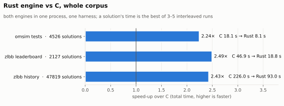
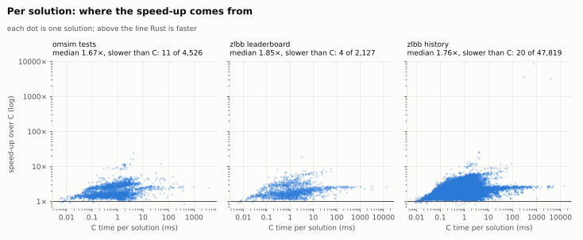
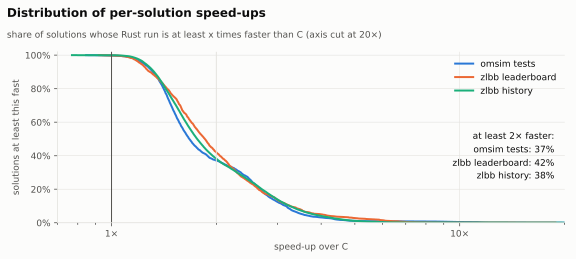
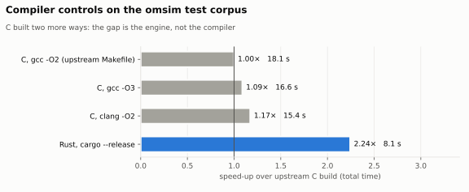

# Rust engine vs C: benchmarks

The Rust engine in `engine/` gives the same results as the C at the root of this
repository and runs **2.2–2.5× faster** on every corpus measured. On the omsim tests it
also stays 1.9–2.1× ahead of the C built with `-O3` or with clang.

<picture>
  <source media="(prefers-color-scheme: dark)" srcset="bench/charts/speedup-dark.svg">
  
</picture>

| corpus | solutions | C | Rust | speed-up | median per solution | slower than C | mismatches |
|---|---:|---:|---:|---:|---:|---:|---:|
| omsim tests (`test/` in this repository) | 4,526 | 18.07 s | 8.05 s | **2.24×** | 1.67× | 11 | 0 |
| zlbb leaderboard snapshot | 2,127 | 46.94 s | 18.82 s | **2.49×** | 1.85× | 4 | 0 |
| zlbb history | 47,819 | 226.03 s | 93.03 s | **2.43×** | 1.76× | 20 | 0 |

## What is measured

- **C**: `libverify.so` from `make libverify.so`, i.e. gcc `-O2` as in the upstream
  Makefile.
- **Rust**: `rust/target/release/libomsim_native.so` from `cargo build --release`.
- **Harness**: `omsim-bench` (`bench/src/main.rs`) loads both libraries into one process
  and calls both through the API of `verifier.h`; the Rust names carry an `rs_` prefix.
  For each solution it creates a verifier from the file bytes, evaluates `cost`,
  `instructions`, `cycles` and `area`, then destroys the verifier. A leaderboard bot does
  the same per submission, and a search loop per candidate.
- **Timing**: each solution runs 5 times per engine (3 times for the zlbb history), in an
  order that alternates every repetition. A solution's time is the fastest of its
  runs. Once a solution's runs pass 2 s in total, no new repetition starts; at least 2
  always run. That cut 64 solutions short.
- **Correctness, in the same run**: every value, and every error with its cycle and
  location, must be identical between the engines. They were for all 54,472 solutions.
- **Machine**: Intel i5-13600KF, Linux 7.2, gcc 16.2.1, clang 22.1.8, rustc 1.99.1
  (LLVM 23.1.1). Each run was pinned to its own performance core with `taskset`. The
  machine was doing other work at the same time; because the engines alternate within
  each solution, the ratios hold, but absolute times may read a few percent high.

## Corpora

- **omsim tests**: `test/solution` in this repository, 4,526 solutions of 174 puzzles:
  the campaign, journal and tournaments, production levels, overlap archives and edge
  cases. 10 end in an error.
- **zlbb leaderboard snapshot**: 2,127 records from the [zlbb](https://zlbb.faendir.com)
  API, fetched 2026-10-24. It takes the minimum and maximum of every metric for each of
  264 puzzles, so the slowest known solutions are included on purpose.
- **zlbb history**: every solution file ever committed to the leaderboard repositories at
  [github.com/zachtronics-leaderboards](https://github.com/zachtronics-leaderboards)
  (`om-leaderboard`, `om-leaderboard-archive`, `om-leaderboard-archive-2`,
  `om-archive`): 48,216 unique files. 47,819 have a puzzle file; 96 of those end in an
  error.

Neither zlbb corpus is part of this repository. Any directory with `puzzles/` and
`solutions/` works; the harness pairs each solution with the puzzle file named after the
puzzle inside it.

## Per solution

<picture>
  <source media="(prefers-color-scheme: dark)" srcset="bench/charts/per-solution-dark.svg">
  
</picture>

<picture>
  <source media="(prefers-color-scheme: dark)" srcset="bench/charts/distribution-dark.svg">
  
</picture>

- **The heavy tail carries the total.** The slowest 1% of solutions take 62–72% of C's
  time. Rust is 2.4–2.6× faster on that 1% and 2.0–2.3× on the other 99%.
- **The extreme points**, at 3,000–8,800×, are solutions that never finish and run into
  the cycle limit. Once the board repeats, the fast-forward skips the remaining periods
  exactly.
- **Slower than C**: 35 of 54,472 solutions. 22 of them take under 50 µs in C, where
  fixed per-verifier costs weigh most. The worst ratio is 0.77× (a 0.6 ms solution).
  The largest is a 0.4 s tournament solution (`OM2021_W6` in the tests), at 0.85×.
  These cases were not investigated further.

## The compiler is not the difference

<picture>
  <source media="(prefers-color-scheme: dark)" srcset="bench/charts/compilers-dark.svg">
  
</picture>

The same run on the omsim tests also built the C two more ways. Built by clang, the C
uses the same LLVM back end as rustc, and that gains 17%. Rust's lead comes from the
engine, not the compiler.

| build | total | speed-up vs upstream C |
|---|---:|---:|
| C, gcc `-O2` (upstream Makefile) | 18.07 s | 1.00× |
| C, gcc `-O3` | 16.60 s | 1.09× |
| C, clang `-O2` | 15.41 s | 1.17× |
| Rust, `cargo build --release` | 8.05 s | 2.24× |

## Why the Rust engine is faster

The engine started as a function-by-function translation of the C. Its speed comes from
exact fast paths: each one must leave every value and every error (cycle and location)
as the C has them.

| fast path | file | what it skips |
|---|---|---|
| periodic fast-forward | `engine/src/ffwd.rs` | whole tape periods, once the board state repeats |
| swept-cell cache | `engine/src/sweep.rs` | re-testing the same cells at every motion sample |
| pairwise prefilter | `engine/src/collision.rs` | colliders that cannot reach an atom's path |
| glyph read plans | `engine/src/glyph_plan.rs` | position lookups around every glyph, every cycle |
| movement trig memo | `engine/src/trig_memo.rs` | recomputing `cos`/`sin` of the same arm angles |

## Build options (measured, not used by default)

The same paired setup on the omsim tests compared build options. The baseline here is
the default Rust build, at 8.33 s in this run.

| build | change |
|---|---:|
| fat LTO | none |
| `RUSTFLAGS="-C target-cpu=native"` | +5% |
| PGO, trained on the leaderboard snapshot | +6% |
| PGO + fat LTO | +7% |

Each option costs portability or a training step for 5–7%, so the default build does
without them. LTO only takes effect on a cdylib-only build:
`CARGO_PROFILE_RELEASE_LTO=fat cargo rustc --release -p omsim-native --crate-type cdylib`.

## Correctness checks

- `cargo test --release --features reference` compiles the C in as an oracle. It
  compares 25 metrics on every test solution, including the steady-state and throughput
  ones: values, errors, cycles and locations. Rust == C. With
  `OMSIM_EXTRA_CORPUS=<dir>`, it does the same on another corpus; the leaderboard
  snapshot matched on all 2,127 × 25.
- `rust/target/release/run-tests` and `./run-tests` print byte-identical output, ending
  in `4526 / 4526 solutions validated!`.
- `rust/target/release/omsim` and `./omsim` print byte-identical output, errors and exit
  codes on all 4,526 test solutions. That holds in all three modes: default, `-s`, and
  `-i` with several `-m` metrics.

## Reproduce

```sh
make libverify.so                                   # the C, as upstream builds it
cd rust && cargo build --release                    # the Rust, and omsim-bench
taskset -c 2 target/release/omsim-bench \
    --lib c=../libverify.so \
    --lib rust=target/release/libomsim_native.so:rs_ \
    --puzzles ../test/puzzle --solutions ../test/solution \
    --reps 5 --out upstream.tsv
uv run --with matplotlib python bench/plot.py bench/charts "omsim tests=upstream.tsv"
```

`--lib` takes any number of libraries. The first one is the oracle; every other one is
checked against it and timed beside it. `--metrics a,b,...` picks the metrics, and
`--filter` selects solutions by path. The tool prints progress every 10 s, then a summary
like:

```
  c            total(min)    18.066s  speed-up vs c 1.000x  mismatches 0
  rust         total(min)     8.054s  speed-up vs c 2.243x  mismatches 0
```

The charts take several corpora, as `LABEL=FILE.tsv` arguments.
